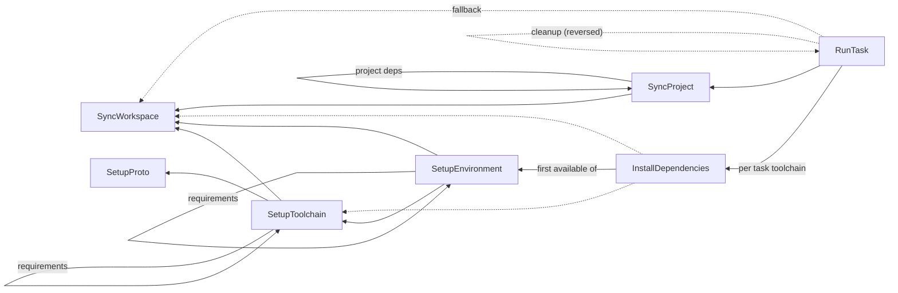

# Action graph: nodes and edges

A reference for the action graph that moon builds before running the action pipeline: every type of
node, every edge between nodes, and the conditions under which each node and edge exists.

Written on 2026-10-15 against `develop-3.0` at `6a680da217`, then updated on `3.0-ag-new` for the
toolchain setup fixes, and again on 2026-10-16 for the new builder (see
[todo/ACTION_GRAPH_BUILDER.md](./todo/ACTION_GRAPH_BUILDER.md)). Line references are as of that
update, and will drift. This describes the behavior of the code, which is the spec: where something
looks surprising, it's called out in [Notes](#notes) instead of being described as the intent.

Source files:

- [action_node.rs](../crates/action/src/action_node.rs): node types and their identity.
- [builder/mod.rs](../crates/action-graph/src/builder/mod.rs): the builder's requests, and its build
  stages.
- [builder/select.rs](../crates/action-graph/src/builder/select.rs): which task instances and
  project syncs exist, and the gates they pass.
- [builder/assemble.rs](../crates/action-graph/src/builder/assemble.rs): every node and edge
  insertion, and provisioning resolution.
- [action_graph.rs](../crates/action-graph/src/action_graph.rs): the built graph, cycle detection,
  and topological sort.
- [job_dispatcher.rs](../crates/action-pipeline/src/job_dispatcher.rs): how the pipeline interprets
  the edges.

## Model

The graph is a `DiGraph<ActionNode, TaskDependencyType>`
([action_graph.rs:12](../crates/action-graph/src/action_graph.rs#L12)). The builder adds edges with
`add_acyclic_edge` and `add_acyclic_edges`
([graph_cycle.rs](../crates/graph-utils/src/graph_cycle.rs)), so edges are rejected on insertion if
they would form a cycle.

**Edge direction.** Every edge points from the node that runs later to the node that runs earlier:
`A → B` means A waits on B. This holds for all edge weights, including cleanup edges (the cleanup
action points at the task it cleans up after). The only thing that differs for cleanup edges is
which side declared the relationship; see [Cleanup](#cleanup-task-dependencies).

**Edge weights.** The weight is the `TaskDependencyType` enum
([task_config.rs:136](../crates/config/src/task_config.rs#L136)):

| Weight     | Meaning in the action graph                                                                                   |
| :--------- | :------------------------------------------------------------------------------------------------------------ |
| `Required` | The source runs after the target completes. Used by every non-task edge, and by serial ordering edges.        |
| `Wait`     | The source starts after the target has started (dispatched), not completed. Only between `RunTask` nodes.     |
| `Cleanup`  | The source runs after the target completes, even if it failed, and even after an abort. Only `RunTask` nodes. |
| `Optional` | Never present. It's a task graph marker, and is normalized to `Required` on every path into the action graph. |

**Requests and stages.** Commands record requests (`run_tasks`, `sync_project`, `setup_toolchain`,
and so on), and nothing happens until `build()`
([builder/mod.rs](../crates/action-graph/src/builder/mod.rs)). The build selects the task instances
and project syncs that exist, applying their gates, as an event log
([select.rs](../crates/action-graph/src/builder/select.rs)). Then it replays the events to insert
nodes and link edges, resolving each task's provisioning actions right before the task
([assemble.rs](../crates/action-graph/src/builder/assemble.rs)). Then it adds the edges that depend
on the whole graph (project syncs, present dependencies, and serial ordering). A graph that's asked
to run one task contains only that task, its dependencies, and the setup chain they need. Nodes are
inserted in a fixed order: a task's project sync and toolchain actions before the task, and the task
before its dependencies.

**Deduplication.** Nodes are deduplicated by identity, and a node that already exists is reused.
Task instances are keyed by target, args, and env, and provisioning and sync nodes by a `NodeKey` of
the fields listed per node below.

**Optional returns.** Every provisioning step returns `Option<NodeIndex>`. `None` means "no node for
this, link nothing", and every edge list is filtered through it. This is how disabled or unsupported
actions disappear from the graph without their dependents needing to know.

### Schema

The node types that may link to each other. A dashed line is a fallback edge, which only exists when
the solid edges from that node produced nothing.

`RunTask`'s edge to `InstallDependencies` is really an edge to the "install slot" for a toolchain,
which resolves to `InstallDependencies`, `SetupEnvironment`, or `SetupToolchain`, depending on what
the toolchain supports. See [InstallDependencies](#installdependencies).

## Nodes

| Node                  | Label                                        | Identity                                               | Outgoing edges to                                              |
| :-------------------- | :------------------------------------------- | :----------------------------------------------------- | :------------------------------------------------------------- |
| `SyncWorkspace`       | `SyncWorkspace`                              | singleton                                              | nothing                                                        |
| `SetupProto`          | `SetupProto(<version>)`                      | proto version                                          | nothing                                                        |
| `SetupToolchain`      | `SetupToolchain(<id> <req>)`                 | `ToolchainSpec` (id + version requirement)             | `SyncWorkspace`, `SetupProto`, other `SetupToolchain`          |
| `SetupEnvironment`    | `SetupEnvironment(<id>[, <root>])`           | toolchain id, root, project id                         | `SyncWorkspace`, `SetupToolchain`, other `SetupEnvironment`    |
| `InstallDependencies` | `InstallDependencies(<id>[, <root>])`        | toolchain id, root, members, project id                | one of `SetupEnvironment`, `SetupToolchain`, `SyncWorkspace`   |
| `SyncProject`         | `SyncProject(<project>)`                     | project id                                             | `SyncWorkspace`, other `SyncProject`                           |
| `RunTask`             | `Run[Interactive\|Persistent]Task(<target>)` | target, interactive, persistent, dependency args + env | `SyncProject`, install slots, `SyncWorkspace`, other `RunTask` |

`ActionNode::None` exists as the enum's default but is never inserted by the builder.

### SyncWorkspace

Syncs the workspace (config schemas, codeowners, VCS hooks, and toolchain and extension
`sync_workspace` hooks), and runs before nearly everything else.
[sync_workspace](../crates/action-graph/src/builder/assemble.rs#L343).

- **Exists when** `options.sync_workspace` is true (`pipeline.syncWorkspace`, default `true`), and
  something asks for it: another node links to it, `moon sync`, or `moon run`/`ci`/`check`/`exec` in
  a CI environment (which always inserts it, even if no task needs it).
- **Outgoing edges:** none. It's a root.

### SetupProto

Installs proto itself. [setup_proto](../crates/action-graph/src/builder/assemble.rs#L351).

- **Identity:** `proto.version` from `.moon/toolchains.yml`, so a singleton in practice.
- **Exists when** a `SetupToolchain` node links to it, or `moon setup` inserts it directly.
- **Outgoing edges:** none. Unlike every other non-root node, it does not link to `SyncWorkspace`.

### SetupToolchain

Downloads and installs a toolchain's tool (tier 3).
[internal_setup_toolchain](../crates/action-graph/src/builder/assemble.rs#L367).

- **Identity:** the `ToolchainSpec`, the toolchain id plus its version requirement. Projects that
  override a toolchain's version (`toolchains.<id>.version` in `moon.yml`) get their own node per
  distinct version; a spec without a version (global) is a separate node again.
- **Exists when all of:**
  - `options.setup_toolchains` is enabled for the toolchain id (always true, except for
    `exec --no-actions` and the `sync projects` command);
  - the spec isn't `system`;
  - the toolchain isn't already on the current recursion path (see [cycles](#cycle-guards));
  - the plugin supports tier 3 (exports `setup_toolchain`, or has a tool with `download_prebuilt`,
    `native_install`, or `build_instructions`), **or** it declared at least one requirement for
    toolchain setup (see below), even when that requirement inserted no node itself.
- **Outgoing edges** (all `Required`):

  | To                           | When                                                                                                                                                                                                                   |
  | :--------------------------- | :--------------------------------------------------------------------------------------------------------------------------------------------------------------------------------------------------------------------- |
  | `SetupToolchain(<required>)` | The plugin's `define_requirements` returns the id in `requires` with `for_setup_toolchain: true`, the id isn't itself or already on the path, and the required toolchain inserts a node. Errors if the id has no spec. |
  | `SyncWorkspace`              | It exists.                                                                                                                                                                                                             |
  | `SetupProto`                 | The spec has a version requirement, or any toolchain in `.moon/toolchains.yml` has a `version` (`ToolchainsConfig::requires_proto`).                                                                                   |

  The spec for a requirement is resolved against the same project as the requiring toolchain
  (project override first, then the workspace config).

### SetupEnvironment

Prepares a toolchain's environment in a dependencies root, before dependencies are installed.
[internal_setup_environment](../crates/action-graph/src/builder/assemble.rs#L449).

- **Identity:** toolchain id, root (workspace-relative, empty for the workspace root), and an
  optional project id.
- **Exists when all of:**
  - `options.setup_environment` is enabled for the toolchain id (always true, except for
    `exec --no-actions` and the `sync projects` command);
  - the spec isn't `system`;
  - the toolchain isn't already on the current recursion path;
  - the plugin exports `setup_environment`, **or** it declared at least one requirement for
    environment setup, **or** the environment of a toolchain it requires exists;
  - something asks for it: the [install slot](#installdependencies), the environment of a toolchain
    that requires it (see below), or `moon setup` via `setup_environment_root`, which additionally
    requires that the located dependencies root is the workspace root
    ([setup_environment_root](../crates/action-graph/src/builder/assemble.rs#L567)).
- **Outgoing edges** (all `Required`):

  | To                             | When                                                                                                                                                                                                                                                               |
  | :----------------------------- | :----------------------------------------------------------------------------------------------------------------------------------------------------------------------------------------------------------------------------------------------------------------- |
  | `SetupToolchain(<required>)`   | `define_requirements` returns the id with `for_setup_environment: true`. Note it requires the toolchain to be _set up_, not its environment.                                                                                                                       |
  | `SetupEnvironment(<required>)` | `define_requirements` returns the id in `requires`, whatever its flags, the id isn't itself or already on the path, and the required toolchain's environment exists after its own gates, in **this** root and with this project. Skipped if it would form a cycle. |
  | `SyncWorkspace`                | It exists.                                                                                                                                                                                                                                                         |
  | `SetupToolchain(<self>)`       | It exists.                                                                                                                                                                                                                                                         |

  Required toolchains (like Node.js and the package managers, required by JavaScript) typically
  don't locate a dependencies root, so their environments never get an install slot of their own.
  Instead they're setup in the root that the requiring toolchain located, before its own
  environment, and so before it installs dependencies. A required toolchain without a spec is an
  error when the requirements are for environment setup, otherwise it's skipped. Required
  environments are linked with `link_environment_edges`, which skips an edge that would form a
  cycle, as toolchains may require each other (like Python and uv): the one reached first wins.

  Edges are linked on every request, even when the node already exists. The toolchain version isn't
  part of its identity, so projects that share a dependencies root but override the version each add
  their own `SetupToolchain`, and the environment waits for all of them.

### InstallDependencies

Installs a toolchain's dependencies in a dependencies root (tier 2).
[install_dependencies](../crates/action-graph/src/builder/assemble.rs#L612).

This is the "install slot" for a toolchain. It's asked for once per toolchain of a task (or of a
project, for `docker setup`), and it always returns the most specific node that exists for that
toolchain, inserting the chain beneath it as it goes. The caller links to whatever comes back.

- **Identity:** toolchain id, root (the located dependencies root, workspace-relative), the
  workspace `members` globs, and an optional project id. The project id is only set when the
  dependencies root is a lone package (no members) and is the project's own root (role
  `PackageRoot`), so that project-level toolchain config reaches the plugin. In a dependencies
  workspace (members), every project that resolves to the same root collapses into **one** node.
- **Resolution**, in order. The first matching row decides what the slot returns:

  | #   | Condition                                                                                                                                                     | Returns                                                       |
  | :-- | :------------------------------------------------------------------------------------------------------------------------------------------------------------ | :------------------------------------------------------------ |
  | 1   | The spec is `system`                                                                                                                                          | `None`                                                        |
  | 2   | `options.install_dependencies` is disabled for the toolchain id (`pipeline.installDependencies`), or the toolchain's `installDependencies` setting is `false` | `SetupToolchain` (or `None` if that doesn't exist)            |
  | 3   | The plugin doesn't support tier 2 (no `locate_dependencies_root`)                                                                                             | `SetupToolchain` (or `None`)                                  |
  | 4   | `locate_dependencies_root` finds no root, or the project's root (workspace root when there's no project) isn't in that dependencies workspace                 | `SetupToolchain` (or `None`)                                  |
  | 5   | The plugin exports `install_dependencies`                                                                                                                     | `InstallDependencies`                                         |
  | 6   | Otherwise                                                                                                                                                     | `SetupEnvironment` if it exists, else `SetupToolchain`/`None` |

  "In that dependencies workspace" means the path is the root itself, or the root has `members` and
  the path relative to the root matches one of the member globs
  ([toolchain_plugin.rs:177](../crates/toolchain-plugin/src/toolchain_plugin.rs#L177)).

  Row 2 means disabling installs never disables toolchain setup: tasks still wait on the toolchain
  being setup, but no `SetupEnvironment` is inserted for it. `SyncWorkspace` and `SetupToolchain`
  are inserted (when enabled) before rows 3–6 are evaluated, and `SetupEnvironment` before rows 5–6,
  so they exist even when the slot returns something else.

- **Outgoing edges:** one `Required` edge per request, to the **first** of `SetupEnvironment`,
  `SetupToolchain`, `SyncWorkspace` that exists (`link_first_available_edge`). The rest are reached
  transitively, as `SetupEnvironment` already links to both. When requests that resolve to the same
  node pass different versions of the toolchain (projects sharing a root that override it), and
  there's no `SetupEnvironment`, each request links its own version's `SetupToolchain`.
- In case 6, the returned `SetupEnvironment` is also linked to the first of `SetupToolchain`,
  `SyncWorkspace`. Both edges already exist from its own insertion, so this adds nothing.

`install_dependencies_root` (no project) returns `None` for rows 1 and 2, then only continues if the
located dependencies root is the workspace root, otherwise it returns `None`.

### SyncProject

Syncs a project through the `sync_project` hooks of its enabled toolchains and of extensions.
[walk_sync_project](../crates/action-graph/src/builder/select.rs#L906) and
[link_synced_projects](../crates/action-graph/src/builder/assemble.rs#L937).

- **Identity:** project id.
- **Exists when all of:**
  - `options.sync_projects` is enabled for the project id (`pipeline.syncProjects`: a boolean, or a
    list of project ids);
  - the project isn't already on the current path of the project sync walk;
  - the project passes the [affected check](#affected-gating), when affected tracking is active and
    not skipped for this insertion.
- **Outgoing edges** (all `Required`):

  | To                   | When                                                                                                                                                                                                                     |
  | :------------------- | :----------------------------------------------------------------------------------------------------------------------------------------------------------------------------------------------------------------------- |
  | `SyncWorkspace`      | It exists.                                                                                                                                                                                                               |
  | `SyncProject(<dep>)` | `options.sync_project_dependencies` is true (`pipeline.syncProjectDependencies`, default `true`), `<dep>` is a **direct** dependency (every scope: production, development, build, peer, and root), and its sync exists. |

  Project sync nodes are inserted while walking each synced project's dependencies, but the edges
  between them are linked once every project sync is known, so that they don't depend on which
  caller synced a project first. Production and peer dependencies are linked first (that partition
  is acyclic), then development, build, and root dependencies, in sorted order, skipping any that
  would close a cycle, as the combined project graph may have cycles across scopes.

### RunTask

Runs a task's command. [enter](../crates/action-graph/src/builder/select.rs#L679).

- **Identity:** target, the interactive and persistent flags (which change the label), plus the
  `args` and `env` from the dependency config that inserted it (env keys sorted for hashing). A task
  inserted as a primary target has no args or env. The same target can therefore be in the graph
  more than once, when tasks depend on it with different `args`/`env`.
- **Flags:**
  - `interactive`: the task is interactive, or the run was started with `--interactive` (which
    applies to every task in the graph, dependencies included).
  - `persistent`: the task's `options.persistent`.
  - `priority`: `options.priority`. It isn't part of the hash, and only affects dispatch order.
- **Exists when** a task was selected (see [Task selection](#task-selection)) or reached as a
  dependency, and it passes these gates, in order:

  | #   | Gate                                                                                                                                           | Effect when it fails             |
  | :-- | :--------------------------------------------------------------------------------------------------------------------------------------------- | :------------------------------- |
  | 1   | The task passes the [affected check](#affected-gating). Dependencies always skip it.                                                           | not inserted                     |
  | 2   | The target isn't already marked passthrough.                                                                                                   | not inserted                     |
  | 3   | When `ci_check` is set, `task.should_run(ci)` per `runInCI`: `false`/`skip` fail in CI, `only` fails outside CI.                               | marked passthrough, not inserted |
  | 4   | A persistent task that wasn't reached as a dependency, when `skip_persistent` is set, or in CI with `ci_check` set and reached as a dependent. | not inserted                     |

  For the `run`/`ci`/`check`/`exec` commands, `ci_check` is on unless `--ignore-ci-checks` is passed
  (`moon ci` always checks), and `ci` is `--ci`, or the detected CI environment (`moon ci` forces
  it). `skip_persistent` has no flag: `moon check` always sets it, and `moon ci` sets it when it
  chose the targets itself (no targets or plan given). Other entry points use
  `RunRequirements::default()`, which has `ci_check` off.

  A passthrough target is skipped everywhere it's referenced from then on, and dependents treat it
  as passed (`TargetState::Passthrough`).

- **Outgoing edges** (excluding task dependencies, all `Required`):

  | To                     | When                                                                                                                                                                                                                              |
  | :--------------------- | :-------------------------------------------------------------------------------------------------------------------------------------------------------------------------------------------------------------------------------- |
  | `SyncProject(<owner>)` | The owning project's node exists after its gates. For a primary target, the project's affected check uses the run's requirements; for a dependency it's skipped.                                                                  |
  | install slot, per id   | For each id in `task.toolchains` that resolves to a spec ([`get_project_spec`](../crates/action-graph/src/builder/mod.rs#L67)): not disabled in the project's `toolchains` config, with the project's version or the workspace's. |
  | `SyncWorkspace`        | Fallback: only when none of the edges above exist, and `SyncWorkspace` is enabled.                                                                                                                                                |

  The fallback guarantees that every `RunTask` reaches `SyncWorkspace` when it's enabled, either
  directly or through one of its other edges.

Once a `RunTask` node exists, a later request for the same identity returns it immediately, without
re-evaluating edges or dependencies.

## Task dependency edges

A task's `deps` are expanded when tasks are built, before the action graph sees them, so every
`dep.target` is a `project:task` target: `:task` dependencies are rejected, and `#tag:task`,
`^:task`, and `~:task` dependencies are expanded into a target for each task. Internal tasks are
allowed, and `--query` never bounds dependencies, as they're always inserted.
[link_dependency](../crates/action-graph/src/builder/select.rs#L825).

Each resolved dependency task is inserted through the same `RunTask` path, with:

- origin `Dependency`, which exempts it from the persistent gate;
- `skip_affected: true`, so dependencies are inserted whether or not they're affected;
- the `args` and `env` from the dependency config, which become part of its identity.

If a dependency fails its gates (for example, `runInCI: false` under `moon ci`), no edge is created
for it.

| Dependency `type`    | Edge                  | Weight     | Notes                                                                                                     |
| :------------------- | :-------------------- | :--------- | :-------------------------------------------------------------------------------------------------------- |
| `required` (default) | task → dependency     | `Required` | Participates in [serial ordering](#serial-ordering-rundepsinparallel-false).                              |
| optional (inherited) | task → dependency     | `Required` | Normalized; the action graph has always used `Required`.                                                  |
| `wait`               | task → dependency     | `Wait`     | Target recorded in `wait_targets`. Not chained serially, as it never runs to completion first.            |
| `cleanup`            | **dependency → task** | `Cleanup`  | Reversed. Dependency index added to `cleanup_indices`, target to `cleanup_targets`. Not chained serially. |

The task always gets a direct edge to each `required`/`wait` dependency, even when serial ordering
also chains them, because a serial edge can be skipped for forming a cycle.

### Cleanup task dependencies

When task `T` declares `deps: [{ target: C, type: cleanup }]`, `C` runs **after** `T`, so the edge
is `C → T` with weight `Cleanup` ([replay](../crates/action-graph/src/builder/assemble.rs#L163)).
It's linked by the caller that owns `T`'s index, after `T` is inserted, and it's skipped if a
`Cleanup` edge already links the pair. `C` may also depend on `T` in another way (for example, a
`required` dep); that's a separate edge with its own weight, and both are kept.

Cleanup dependencies are inserted even under `--no-dependencies`, as they must always run after the
task.

### Serial ordering (`runDepsInParallel: false`)

When a task sets `options.runDepsInParallel: false`, its `required` dependencies run one after
another, and so does each dependency's whole task subtree
([link_serial_required_edges](../crates/action-graph/src/builder/assemble.rs#L1135)). For
dependencies `d1, d2, d3` in declared order, with `prev` the last required dependency so far and
`prev_standard` the last required dependency that isn't persistent:

1. A serial link is recorded when `d_i` is reached, and applied once every real edge exists, in the
   same order. Applying it walks `d_i`'s subtree: `d_i` plus every `RunTask` it reaches over
   `Required` edges, skipping serial edges, present dependency edges, `Wait` and `Cleanup` edges,
   and non-task nodes.
2. For each node `x` in that subtree, add `x → anchor` (`Required`), where `anchor` is `prev` if `x`
   is persistent, else `prev_standard`. A persistent action is marked completed when dispatched, so
   ordering a standard action after one would run it immediately; it's ordered after the last
   dependency that actually completes instead.
3. Then `d_i` becomes `prev` (and `prev_standard`, unless it's persistent).

Serial edges are a preference, not a dependency:

- They're added with [`try_link_edge`](../crates/action-graph/src/builder/assemble.rs#L851), which
  silently skips an edge that would form a cycle, or that duplicates an existing `Required` edge.
  This happens when the same node is in the serial chains of several parents, or when a real
  dependency links the nodes the other way.
- As every real edge exists before any serial edge is added, a serial edge is never added and then
  removed: one that contradicts a dependency is skipped instead.
- Each is recorded in `serial_edges`, so the subtree walk doesn't follow it.

### Present-dependency edges (`--no-dependencies`)

With `no_dependencies`, a selected task's non-cleanup dependencies aren't inserted. Instead, when
the graph is built, each of its dependencies that **already has a node** (because it was selected
itself, or reached through another task) gets an edge, regardless of insertion order
([link_present_dependencies](../crates/action-graph/src/builder/assemble.rs#L1001)):

- The edge is task → dependency, weighted `Required` (or `Wait`).
- If the dependency target has several nodes, those whose `args` and `env` match the dependency
  config are linked; if none match, all of them are.
- No edge is added if one of that weight already links the owner to any of the candidates.
- A dependency without a node is recorded in `ignored_dependencies`, so the task neither waits on
  nor hashes it.
- Serial ordering isn't applied to these edges.

## Affected gating

When affected tracking is active (`moon run --affected`, `moon ci`, and so on) and not skipped for
the insertion, a `RunTask` or `SyncProject` node is only inserted if its task or project is marked
affected ([is_task_affected](../crates/action-graph/src/builder/select.rs#L1025),
[is_project_affected](../crates/action-graph/src/builder/select.rs#L992)). Affected state is
computed up front (`track_affected`, then `track_tasks` when selecting `run_tasks`), so insertion
order doesn't change the result. Project syncs are checked while selecting, at the point where the
task that owns them is inserted, as marking a task affected also marks its project, so the order of
the checks matters.

The check is skipped:

- for every task dependency, and the owning projects of dependencies (`skip_affected: true` is
  passed down the dependency chain);
- for the whole run with `--force`, or when not running affected.

Because `SyncProject` is gated separately from `RunTask`, an affected task whose project isn't
marked affected has no `SyncProject` edge, and links to its install slots (or the `SyncWorkspace`
fallback) instead. A project's dependencies are gated the same way, so `SyncProject → SyncProject`
edges only exist between affected projects.

## Task selection

Which tasks become primary `RunTask` nodes is decided before any edges are linked
([select_tasks](../crates/action-graph/src/builder/select.rs#L426)):

1. Resolve each target locator to tasks. Internal tasks are excluded. A `:task` locator is bounded
   by `--query` when one is set (glob locators aren't).
2. Deduplicate, then append dependents of the selected tasks up to `--dependents` depth
   ([resolve_dependents](../crates/action-graph/src/builder/select.rs#L1060)). The walk follows
   incoming task graph edges, **except** `cleanup` edges, and skips projects that don't match
   `--query`. Internal tasks aren't added, as they only run as a dependency of another task, but the
   walk continues through them, so the dependents beyond them are added (and those insert the
   internal task as a dependency). A task that was both selected and reached as a dependent counts
   as requested.
3. Track affected state for every candidate (or every task, when affected state flows through
   relations).
4. When partitioning into jobs (`--job`/`--job-total`, or an execution plan's partitioned jobs),
   drop unaffected candidates, then keep this job's slice.
5. Insert each remaining candidate through the `RunTask` path, with origin `Requested` or
   `Dependent`. Every candidate that produces a node is recorded as a primary target.

## Cycle guards

There are four different mechanisms, and they behave differently:

- **Path sets.** `SetupToolchain` and `SetupEnvironment` resolution carries a set of the toolchains
  on the current recursion path, and the project sync walk keeps a set of the projects on its stack.
  A requirement or project dependency that's already on the path isn't walked again. The sets are
  path-local, so siblings that share a dependency both reach it.
- **Skipped edges.** Preferences are skipped when they would form a cycle, instead of failing the
  build: serial ordering edges, required environments, requirements between toolchain setups (when
  two toolchains require each other), and project sync edges outside the production and peer scopes.
- **Edge insertion.** [`link_edge`](../crates/action-graph/src/builder/assemble.rs#L819) rejects a
  real dependency edge that would form a cycle, and fails the build with
  `ActionGraphError::WouldCycle`, which names that edge, and describes the whole cycle in its help.
- **Sort time.** `sort_topological` checks for cycles again and fails with `CycleDetected`
  ([action_graph.rs:113](../crates/action-graph/src/action_graph.rs#L113)).

## Builder options

`ActionGraphBuilderOptions`
([action_graph_options.rs:55](../crates/action-graph/src/action_graph_options.rs#L55)) gate whole
node types. A `PipelineActionSwitch` is `Default` (enabled), `Enabled(bool)`, or `Only(ids)`
(enabled for the listed ids).

| Option                      | Gates                                                                                     | Keyed by     | Source (`session.build_action_graph`) |
| :-------------------------- | :---------------------------------------------------------------------------------------- | :----------- | :------------------------------------ |
| `install_dependencies`      | `InstallDependencies` and `SetupEnvironment` from the install slot (not `SetupToolchain`) | toolchain id | `pipeline.installDependencies`        |
| `setup_environment`         | `SetupEnvironment`                                                                        | toolchain id | always `true`                         |
| `setup_toolchains`          | `SetupToolchain`                                                                          | toolchain id | always `true`                         |
| `sync_projects`             | `SyncProject`                                                                             | project id   | `pipeline.syncProjects`               |
| `sync_project_dependencies` | `SyncProject → SyncProject` edges                                                         | n/a          | `pipeline.syncProjectDependencies`    |
| `sync_workspace`            | `SyncWorkspace`                                                                           | n/a          | `pipeline.syncWorkspace`              |

Per-toolchain config adds two more gates: a toolchain's `installDependencies: false` in
`.moon/toolchains.yml` reduces its install slot to toolchain setup (row 2), and a project's
`toolchains.<id>` set to disabled removes the toolchain from that project's tasks entirely.

## Entry points

Which commands seed the graph, with which options, and through which builder requests. Requests only
record what to build, and results (like the partition that `exec` prints) are read from the
`BuildReport` that `build()` returns.

| Command                                | Options                                                | Seeds                                                                                                                                                       |
| :------------------------------------- | :----------------------------------------------------- | :---------------------------------------------------------------------------------------------------------------------------------------------------------- |
| `moon run`, `ci`, `check`, `exec`      | pipeline config; all disabled with `--no-actions`      | `sync_workspace` in CI, then `run_tasks_with_plan` ([exec.rs:446](../crates/app/src/commands/exec.rs#L446))                                                 |
| `moon action-graph [targets]`          | pipeline config                                        | `run_task_by_target` per target, or `run_task` for every task                                                                                               |
| `moon sync`                            | all enabled (ignores pipeline config)                  | `sync_workspace`, `sync_project` for every project, and `run_task` for every task with `runInSyncPhase`                                                     |
| `moon sync projects`                   | only `sync_projects` and `sync_project_dependencies`   | `sync_project` for every project                                                                                                                            |
| `moon setup`                           | only `setup_toolchains` and `setup_environment`        | `setup_proto`, then `setup_toolchain_and_environment` for every configured toolchain, which sets up the root environment when the toolchain inserted a node |
| `moon docker setup`                    | pipeline config                                        | `install_dependencies_by_project` for every focused project (an install slot per project toolchain)                                                         |
| MCP `sync_workspace` / `sync_projects` | all enabled; `sync_projects` disables `sync_workspace` | `sync_workspace` / `sync_project`                                                                                                                           |

## How the pipeline reads edges

The job dispatcher merges every edge between the same pair of nodes into a `Relation` with
`required`, `wait`, and `cleanup` flags
([job_dispatcher.rs:14](../crates/action-pipeline/src/job_dispatcher.rs#L14)), and self edges are
dropped.

- A node is dispatchable once every dependency is released. A dependency is released when it
  **completes** (success or failure), except when every edge to it is `Wait`, in which case it's
  released when it's **dispatched**.
- A failed `SetupProto`, `SetupToolchain`, `SetupEnvironment`, or `InstallDependencies` aborts the
  pipeline ([action_runner.rs:259](../crates/action-pipeline/src/action_runner.rs#L259)). Other
  nodes are released on completion regardless of outcome; a task with a dependency that failed or
  was skipped is itself skipped when it's run, instead of running its command.
- Nodes in `cleanup_indices` can still be dispatched after an abort, once there's something to clean
  up and their own dependencies allow it
  ([take_cleanups_after_abort](../crates/action-pipeline/src/job_dispatcher.rs#L306)). A cleanup is
  skipped as needless when none of the tasks it cleans up after ran their command (cached or
  skipped) or started a `wait` dependency, nothing else requires it, and it isn't a primary target
  ([is_needless_cleanup](../crates/action-pipeline/src/job_dispatcher.rs#L520)).
- A persistent node is marked completed when it's dispatched, which is why serial ordering anchors
  standard tasks to the previous non-persistent dependency.
- Nodes are grouped by priority (`RunTask` priority; every other node is `0`, critical). For
  critical and high groups, the dispatcher looks ahead into a blocked node's dependencies for one it
  can run.

## Graph invariants

- The graph is acyclic. Every edge is checked on insertion, and again when sorting.
- Each identity has one node.
- When `SyncWorkspace` is enabled, every node except `SyncWorkspace` and `SetupProto` reaches it.
- No setup or sync node ever links to a `RunTask` node. Task nodes only receive edges from other
  task nodes.
- `Optional` never appears as an edge weight; `Cleanup` and `Wait` only appear between `RunTask`
  nodes.
- Redundant edges are kept: no transitive reduction is done, as it doesn't change execution order,
  is costly on large graphs, and cleanup handling reads direct edges.
- Node indices are preserved when the builder's graph is mapped into the final `ActionGraph`, so
  `cleanup_indices` stays valid.

## Build outputs besides the graph

`build()` returns the graph, a `BuildReport` with the result of each request (the nodes it produced,
and the partition of a `run_tasks` request), and an `ActionContext` with state collected while
building:

| Field                  | Contents                                                                 |
| :--------------------- | :----------------------------------------------------------------------- |
| `primary_targets`      | Targets inserted by the top-level run methods (selected, or dependents). |
| target states          | Every passthrough target, as `TargetState::Passthrough`.                 |
| `ignored_dependencies` | Per task, the dependencies that had no node under `--no-dependencies`.   |
| `cleanup_targets`      | Targets depended on as `cleanup`.                                        |
| `wait_targets`         | Targets depended on as `wait`.                                           |
| `changed_files`        | The changed files passed to the builder.                                 |
| `affected`             | The built affected state, when tracking was enabled.                     |

## Notes

Behaviors that follow from the code above, and may be worth a second look:

1. **`SetupProto` doesn't link `SyncWorkspace`.** It's the only non-root node that doesn't, so it
   may run before or in parallel with the workspace sync.
2. **`SetupProto` gating is workspace-wide.** `requires_proto()` is true if any toolchain in
   `.moon/toolchains.yml` has a version, so a global (unversioned) toolchain still depends on
   `SetupProto` in that case. The graph also doesn't consult `MOON_TOOLCHAIN_FORCE_GLOBALS`; the
   node is inserted, and the `setup_proto` action skips itself at runtime.
3. **Requirement-only toolchains are inserted unconditionally.** A toolchain without tier 3 (or
   without `setup_environment`) is still inserted when it declares a requirement, even if that
   requirement produced no node (for example, the required toolchain has no tier 3 support itself),
   because the check is on the edge list's length, not on whether any edge resolved. Required
   environments are the exception: they only count when they exist.
4. **`moon sync` ignores `pipeline.*`.** It uses `ActionGraphBuilderOptions::default()`, which
   enables every action type regardless of workspace config. So do the MCP sync tools.
