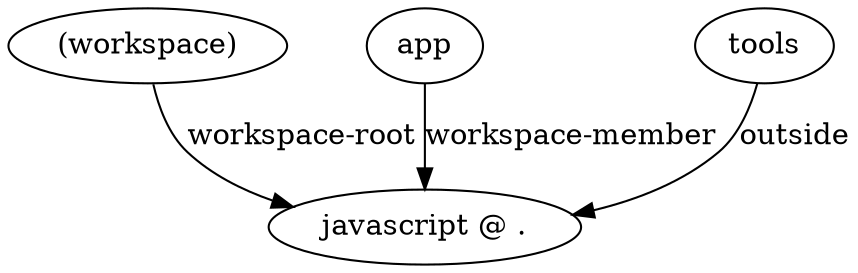

import VersionLabel from '@site/src/components/Docs/VersionLabel';

<VersionLabel version="3.0.0" header />

The `moon layout-graph [id]` (or `moon lg`) command will generate and serve a visual graph of the
dependencies roots that toolchains locate, like a package manager's workspace or a standalone
package, and the projects that belong to each root, with their role as edges. It can also output
the graph in [Graphviz DOT format](https://graphviz.org/doc/info/lang.html) or JSON.

With `--info`, it instead prints each root: its kind (workspace or package), member globs, owner
project, the version that its environment setup and dependency installs run with, its lockfiles,
manifests, and vendor directory, and its projects with their role. Projects that use a toolchain
without belonging to one of its roots, like a project that isn't a member of the workspace that
it's located in, are listed separately.

```shell
# Run the visualizer locally
$ moon layout-graph

# Print information about each root
$ moon layout-graph --info

# Only place a single project, like a run would
$ moon layout-graph app --info

# Export to DOT format
$ moon layout-graph --dot > graph.dot

# Export to JSON format
$ moon layout-graph --json
```

### Arguments

- `[id]` - Optional ID or alias of a project to _only_ place, as defined in
  [`projects`](../config/workspace#projects). Roots then only list the projects that were placed.

### Options

- `--dot` - Print the graph in DOT format.
- `--host` - The host address. Defaults to `127.0.0.1`.
- `--info` - Print information about each root and its projects, instead of serving the graph.
- `--json` - Print the graph in JSON format, with every root and binding.
- `--port` - The port to bind to. Defaults to a random port.

### Configuration

- [`projects`](../config/workspace#projects) in `.moon/workspace.*`
- [`toolchains`](../config/toolchain) in `.moon/toolchains.*`

## Example output

The following output is an example of the graph in DOT format, where projects link to the root that
they belong to, labeled with their role.


