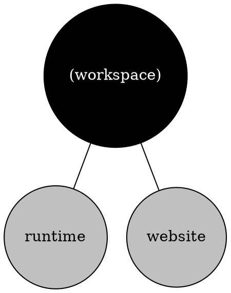

import VersionLabel from '@site/src/components/Docs/VersionLabel';

The `moon project-graph [id]` (or `moon pg`) command will generate and serve a visual graph of all
configured projects as nodes, with dependencies between as edges, and can also output the graph in
[Graphviz DOT format](https://graphviz.org/doc/info/lang.html).

```shell
# Run the visualizer locally
$ moon project-graph

# Export to DOT format
$ moon project-graph --dot > graph.dot

# Focus a specific project
$ moon project-graph app

# Focus a specific project, and include its direct dependents
$ moon project-graph app --dependents direct
```

### Arguments

- `[id]` - Optional ID or alias of a project to focus, as defined in
  [`projects`](../config/workspace#projects).

### Options

- `--dependents <DEPTH>` - Include dependents of the focused project, up to the depth. Supports
  "none" (default), "direct", "deep", or a number of hops. <VersionLabel version="3.0.0" />
- `--dot` - Print the graph in DOT format.
- `--host` - The host address. Defaults to `127.0.0.1`. <VersionLabel version="1.36.0" />
- `--json` - Print the graph in JSON format.
- `--port` - The port to bind to. Defaults to a random port. <VersionLabel version="1.36.0" />

### Configuration

- [`projects`](../config/workspace#projects) in `.moon/workspace.*`

## Example output

The following output is an example of the graph in DOT format.


